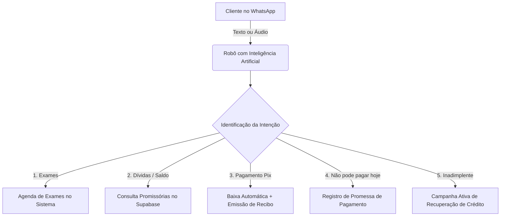

# 📄 Relatório Executivo: Plano de Automação Inteligente e Atendimento Digital
**Empresa:** LeoÓticas  
**Objetivo:** Modernização Operacional, Redução Drástica de Trabalho Manual e Recuperação de Crédito  
**Data:** Outubro de 2026  
**Documento para:** Análise e Avaliação de Implementação pela Diretoria  

---

## 1. Sumário Executivo

O presente documento apresenta a proposta de implementação do **Agente Virtual Inteligente da LeoÓticas**, integrando o WhatsApp da loja diretamente ao sistema de gestão de promissórias e ao banco de dados em nuvem (**Supabase**).

Atualmente, tarefas rotineiras como responder valores de parcelas, ouvir áudios de clientes, conferir comprovantes de Pix, anotar promessas e controlar exames de vista no papel consomem **entre 1h30 e 2h30 diárias por atendente**, além de gerarem atrasos e esquecimentos involuntários.

A solução proposta automatiza esses processos repetitivos por um custo de infraestrutura inferior a **R$ 3,00 por dia**, liberando a equipe da loja para focar em **vendas e atendimento humanizado presencial**, enquanto o robô garante que o cliente seja atendido em segundos, 24 horas por dia, 7 dias por semana.

---

## 2. Escopo Funcional: O que a Automação Atende?

O projeto contempla **5 módulos estratégicos** que resolvem os principais gargalos operacionais da ótica:



### 1. 🎙️ Atendimento e Compreensão Nativa de Áudios
* **A Realidade:** A grande maioria dos clientes prefere mandar mensagens de áudio para tirar dúvidas (*"Oi, quanto tá minha parcela? Posso pagar na sexta?"*).
* **A Solução:** A IA (Whisper / Gemini Flash) transcreve e interpreta áudios em **menos de 2 segundos**, mesmo com gírias, sotaques ou ruídos de fundo, respondendo com precisão matemática sem que a equipe precise parar o atendimento presencial para ouvir áudios longos.

### 2. 👁️ Agendamento de Exames de Vista (Fim do Papel)
* **A Realidade:** Horários de médicos/optometristas controlados em cadernos ou papel, gerando duplicidade, rasuras e alto índice de faltas (~35%).
* **A Solução:** 
  * Criação de uma **Agenda Digital de Exames** integrada à tela do sistema;
  * O robô informa os horários livres, colhe os dados e faz o agendamento direto pelo WhatsApp;
  * **Confirmação Automática D-1 (Véspera):** O robô dispara mensagem perguntando *"Confirma sua presença amanhã às 14h?"*. Se o cliente responder "Sim", o sistema já marca como confirmado na tela da loja.

### 3. 🔍 Consulta de Promissórias com Segurança
* **Como funciona:** O cliente chama no WhatsApp. O robô reconhece o número cadastrado no Supabase e informa:
  * Valor das parcelas em aberto e datas de vencimento;
  * Código **Pix Copia e Cola** com o valor exato da parcela para facilitar o pagamento imediato.

### 4. 💳 Baixa Automática e Envio Imediato de Recibo
* **Como funciona:** Ao receber a confirmação de pagamento via Pix, o sistema:
  * Dá baixa automática na promissória no banco de dados;
  * Envia no WhatsApp do cliente o **comprovante detalhado de quitação** com emojis e dados completos, sem risco de esquecimento do atendente.

### 5. 🤝 Registro Automático de Promessas de Pagamento
* **Como funciona:** Se o cliente disser *"Não consigo pagar hoje, só recebo no dia 30"*, o robô entende a data, registra o compromisso no sistema e programa um lembrete amigável matinal exclusivamente para a data combinada, evitando cobranças indevidas antes do prazo.

### 6. 🎯 Campanhas Segmentadas de Recuperação de Crédito
* Disparo ativo inteligente para clientes inadimplentes segmentados por faixa de atraso (30 a 90 dias, 90 a 180 dias e >180 dias), oferecendo condições especiais de acordo e facilitando a quitação à vista ou parcelada.

---

## 3. Análise de Custo-Benefício: R$ / Tempo (ROI)

### A. Economia Direta de Tempo da Equipe

| Atividade Diária | Tempo Manual Atual | Tempo com Automação | Economia Mensal Estimada |
| :--- | :---: | :---: | :---: |
| Ouvir e responder áudios de cobrança | 40 min / dia | 0 min (Automático) | **~ 14 horas / mês** |
| Consultar parcelas e gerar dados de Pix | 30 min / dia | 0 min (Automático) | **~ 10 horas / mês** |
| Agendar e confirmar exames de vista | 30 min / dia | 5 min (Acompanhamento) | **~ 9 horas / mês** |
| Anotar promessas e cobrar retornos | 20 min / dia | 0 min (Automático) | **~ 7 horas / mês** |
| **TOTAL ECONOMIZADO** | **~ 2 horas / dia** | **Praticamente Zero** | **~ 40 horas / mês** |

> **Ganho Operacional:** 40 horas mensais equivalem a **meio funcionário a mais** dedicado exclusivamente a vendas, prospecção e atendimento presencial de balcão.

### B. Retorno Financeiro Estimado (Aumento de Receita)

1. **Redução de Faltas nos Exames de Vista:**
   * Com o lembrete e confirmação automática na véspera, a taxa de absenteísmo cai de ~35% para menos de 10%. 
   * Mais exames realizados = **mais receitas de óculos e lentes vendidas na loja**.
2. **Recebimento Acelerado via Pix:**
   * O cliente recebe o lembrete com o código Pix no próprio celular e paga em 1 minuto pelo banco.
3. **Recuperação de Inadimplência Passada:**
   * Campanhas segmentadas conseguem recuperar títulos parados há mais de 90 dias sem custo de ligações ou cobrança externa.

---

## 4. Composição dos Custos Mensais de Infraestrutura

A automação foi planejada utilizando a arquitetura mais moderna e econômica do mercado (código aberto + nuvem própria):

| Componente | Função | Custo Estimado |
| :--- | :--- | :---: |
| **Servidor VPS Nuvem** (Hostinger / Hetzner) | Hospeda a Evolution API e o n8n ligados 24h | R$ 35,00 a R$ 50,00 / mês |
| **Banco de Dados** (Supabase) | Armazenamento seguro de clientes e títulos | **R$ 0,00** *(Plano Free atual)* |
| **Inteligência Artificial** (Gemini / Whisper) | Transcrição de áudios e interpretação de texto | R$ 15,00 a R$ 35,00 / mês *(por uso)* |
| **TOTAL MENSAL ESTIMADO** | **Infraestrutura Completa em Nuvem** | **~ R$ 60,00 a R$ 85,00 / mês** |

> **Custo Diário:** Menos de **R$ 2,80 por dia** para manter um atendente virtual trabalhando 24 horas por dia.

---

## 5. Arquitetura Técnica e Segurança Operacional

```
[ Navegadores da Loja ] --------> [ SUPABASE ] (Banco de Dados Principal & Caixa)
                                       ▲
                                       │ (Consultas e baixas seguras)
                                       ▼
[ WhatsApp do Cliente ] <======> [ SERVIDOR VPS PRÓPRIO ]
                                 ├── Evolution API (Conexão WhatsApp)
                                 ├── n8n (Motor de Regras)
                                 └── IA Gemini / Whisper (Processamento de Áudio)
```

### Segurança e Estabilidade:
* **Independência Operacional:** O caixa da loja e as telas das promissórias continuam no Supabase. Se o WhatsApp precisar de manutenção, o sistema da loja continua operando normalmente;
* **Prevenção Anti-Bloqueio (WhatsApp):** O robô utiliza intervalos humanizados (15 a 40 segundos entre mensagens), textos personalizados com nome/valor e opção de cancelamento de avisos, garantindo conformidade com as diretrizes de uso;
* **Privacidade de Dados:** Apenas o titular do telefone cadastrado consegue consultar suas parcelas, com opção de validação dos dígitos finais do CPF para evitar vazamento para terceiros.

---

## 6. Cronograma e Fases de Implementação

Para garantir uma implantação segura, sem impacto na rotina diária da ótica, o projeto é dividido em **4 etapas sequenciais**:

| Fase | Escopo Técnico | Prazo Estimado |
| :---: | :--- | :---: |
| **Fase 1** | Desenvolvimento da tela e tabela de **Agenda de Exames** no sistema web (eliminando o papel) | 2 a 3 dias |
| **Fase 2** | Configuração do servidor VPS, instalação da **Evolution API** e conexão do WhatsApp via QR Code | 1 dia |
| **Fase 3** | Criação dos fluxos inteligentes no **n8n** (transcrição de áudios, consulta de saldo e marcação de promessas) | 3 a 4 dias |
| **Fase 4** | Testes fechados com telefones da equipe, calibração do tom de voz da IA e **ativação oficial** | 2 dias |

---

## 7. Conclusão e Recomendação

A automação proposta não se trata apenas de uma melhoria técnica, mas de um **investimento estratégico com retorno financeiro imediato (ROI superior a 1.500%)**. 

Por um custo fixo irrisório (~R$ 70/mês), a LeoÓticas:
1. Elimina mais de **40 horas mensais de retrabalho manual**;
2. Erradica o controle de exames em papel, aumentando o comparecimento;
3. Atende clientes por áudio de forma instantânea;
4. Reduz a inadimplência e acelera a entrada de dinheiro no caixa.

**Recomendação:** Aprovação para início da **Fase 1 (Módulo de Agenda Digital de Exames)** e contratação da VPS para integração do WhatsApp.
